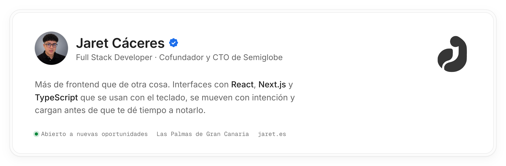
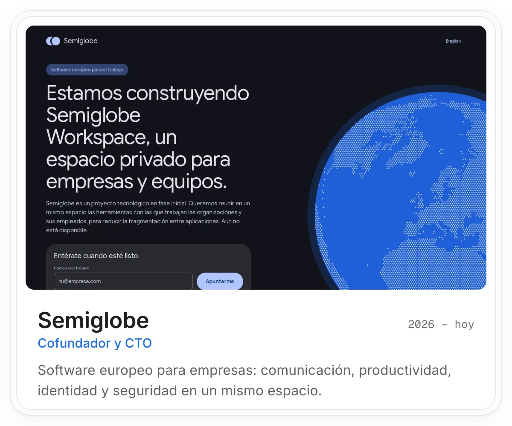
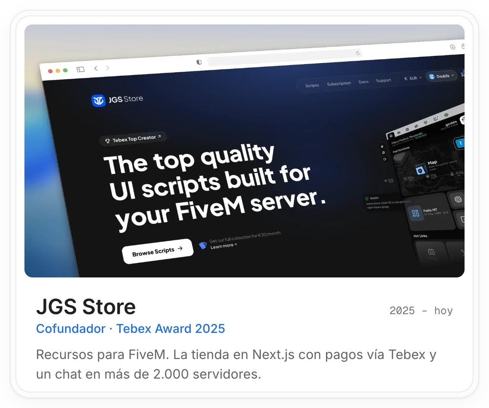
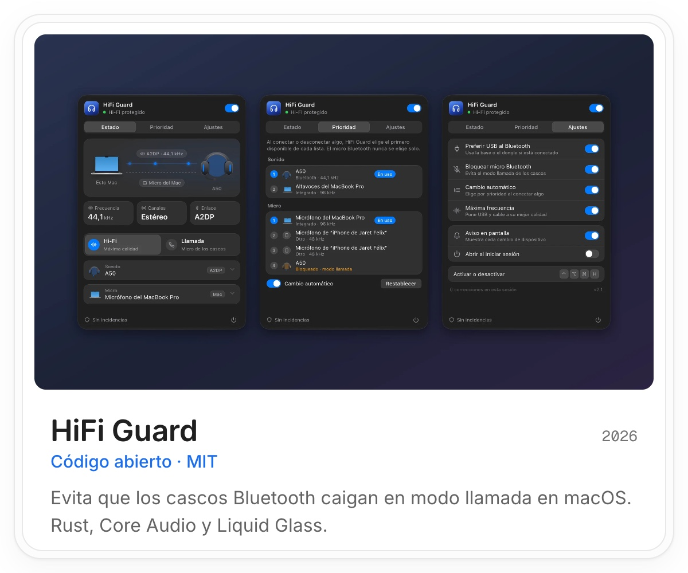
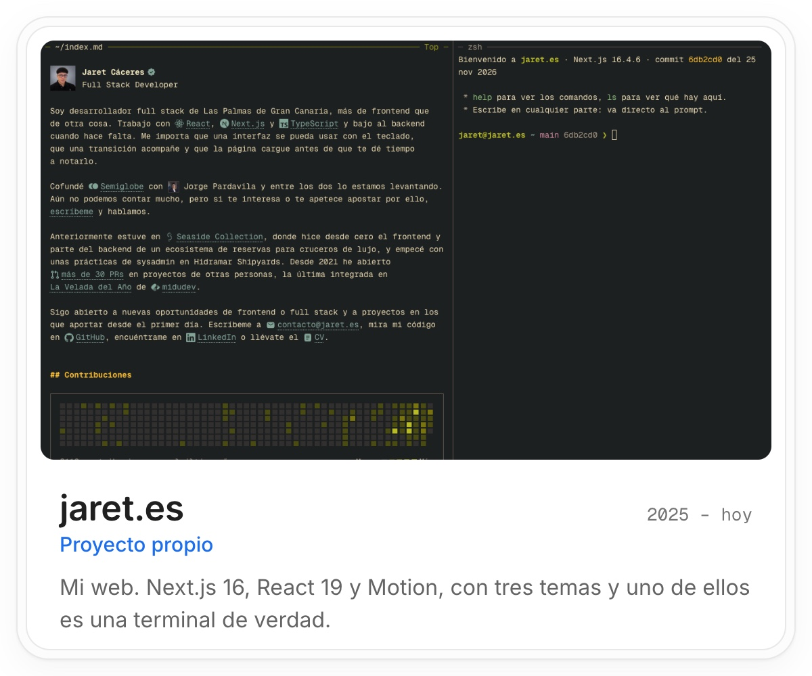

<a href="https://jaret.es">
  <picture>
    <source media="(prefers-color-scheme: dark)" srcset="assets/header-dark.png">
    
  </picture>
</a>

  <a href="https://jaret.es"><b>jaret.es</b></a> ·
  <a href="https://jaret.es/writing">Escritos</a> ·
  <a href="https://jaret.es/projects">Proyectos</a> ·
  <a href="https://jaret.es/jaret-caceres-perfil-profesional.pdf">CV</a> ·
  <a href="https://linkedin.com/in/jaretcaceres">LinkedIn</a> ·
  <a href="https://x.com/jaretcaceres">X</a> ·
  <a href="mailto:contacto@jaret.es">contacto@jaret.es</a>

## Ahora

Cofundé **[Semiglobe](https://semiglobe.es)** con Jorge Pardavila y soy su CTO. Estamos construyendo Semiglobe Workspace, un espacio de trabajo privado para empresas y equipos. Antes hice desde cero el frontend y parte del backend de un ecosistema de reservas para cruceros de lujo en **Seaside Collection**, con una capa BFF, integraciones con PMS y CRM y bastante trabajo de TTFB.

## Proyectos

  <a href="https://semiglobe.es"><picture><source media="(prefers-color-scheme: dark)" srcset="assets/projects/semiglobe-dark.jpg"></picture></a>
  <a href="https://jgs-store.com"><picture><source media="(prefers-color-scheme: dark)" srcset="assets/projects/jgs-store-dark.jpg"></picture></a>

  <a href="https://github.com/jaretcaceres/hifi-guard"><picture><source media="(prefers-color-scheme: dark)" srcset="assets/projects/hifi-guard-dark.jpg"></picture></a>
  <a href="https://jaret.es"><picture><source media="(prefers-color-scheme: dark)" srcset="assets/projects/jaret-es-dark.jpg"></picture></a>

## Open source

Desde 2021 he abierto **más de 30 PRs** en proyectos de otras personas. Dos destacadas:

- **[levelsio/xdr-boost](https://github.com/levelsio/xdr-boost/pull/16)**: un panel de control en la barra de menús y [un arreglo](https://github.com/levelsio/xdr-boost/pull/15) para el brillo que parpadeaba al cambiar de escritorio.
- **[midudev/la-velada-web-oficial](https://github.com/midudev/la-velada-web-oficial/pull/1444)**: datos de redes y canales de YouTube de los boxeadores en la web de La Velada. Integrada.

Todas, con su estado, en [jaret.es/projects/open-source](https://jaret.es/projects/open-source).

## Últimos escritos

<!-- writing:start -->
- [Unos cascos que no suenen a llamada](https://jaret.es/writing/unos-cascos-que-no-suenen-a-llamada) · 25 oct 2026
- [El brillo que se iba al cambiar de escritorio](https://jaret.es/writing/el-brillo-que-se-iba-al-cambiar-de-escritorio) · 20 oct 2026
- [Por qué esta web vuelve a Next.js](https://jaret.es/writing/por-que-esta-web-vuelve-a-nextjs) · 20 oct 2026
- [Un panel para XDR Boost en la barra de menús](https://jaret.es/writing/un-panel-para-xdr-boost) · 20 oct 2026
- [El foco que no se ve en Tailwind CSS v4](https://jaret.es/writing/el-foco-que-no-se-ve) · 5 oct 2026
<!-- writing:end -->

Se actualiza solo cada día desde [el feed de jaret.es](https://jaret.es/feed.json).

## Con qué trabajo

  

 

  Las Palmas de Gran Canaria · <a href="mailto:contacto@jaret.es">¿Hablamos?</a>

